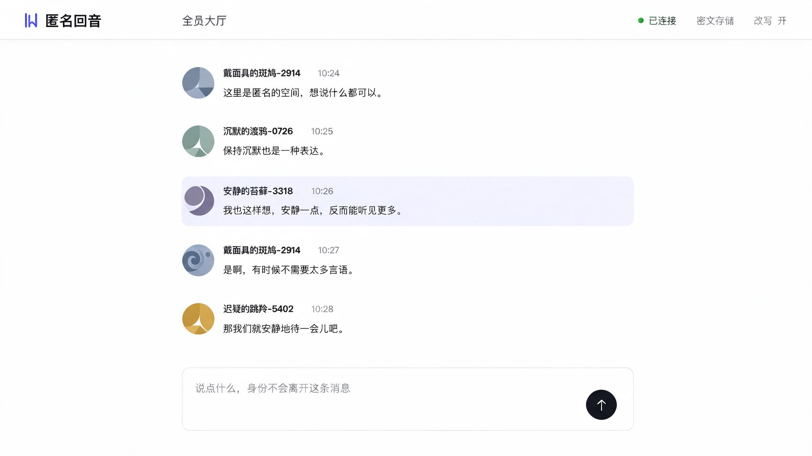

# 匿名回音 · Echo Room

企业内部匿名意见箱式的聊天室：**实名准入、匿名发言、消息加密落库**，追责要凑齐 K 份密钥分片。

> 个人小项目，vibe coding 产物，还在打磨。不保证及时修 bug，也可能不回 issue。



> 界面示意图。前端样式集中在 `src/index.css` / `src/styles.css`，风格可自行改。

## 有什么

| 能力 | 说明 |
|---|---|
| 准入 | 邀请码 + 本地账号（scrypt）；OIDC 预留，默认关闭 |
| 匿名 | 注册即随机昵称 + 确定性头像；界面、广播、历史里都不出现真实身份 |
| 聊天 | 多房间、WebSocket 实时收发、在线人数、限流 |
| 语气归一化 | 广播前抹平口头禅/标点/句式；provider 可选 OpenAI 兼容 / Ollama / 扣子 / 关闭 |
| 存储 | 原文 AES-256-GCM 密文入库，接口只返回归一化文本 |
| 保险库 | 身份映射整表加密 + Shamir K/N 分片；平时封存，溯源需 K 份分片 + 事由 + 审计 |
| 后台 | 房间/内容/邀请码/LLM 配置；审计与内容治理已脱敏（`admin#N` + 不可逆短引用） |

技术栈：Vite + 原生 TS / Fastify 5 + TS / PostgreSQL / Redis / ws。

## 跑起来

环境要求：**Node.js 24** + **pnpm >= 9**。

Docker（推荐）：

```bash
cp .env.example .env
openssl rand -base64 48   # → JWT_SECRET
openssl rand -base64 32   # → MESSAGE_ENCRYPTION_KEY
# 再改 ADMIN_USERNAMES，并设置 BOOTSTRAP_INVITE_CODES（没有内置默认码）
docker compose up -d --build   # http://localhost:5000
```

本地开发（PGlite，不需要 Docker）：

```bash
pnpm install && pnpm dev:local
```

`pnpm dev` 是扣子平台内开发用的启动方式（依赖平台胶水脚本），平台外请用 `pnpm dev:local`。

上线前请按 [部署文档](docs/DEPLOYMENT.md) 做引导与解封；安全底线见 [安全基线](docs/SECURITY_BASELINE.md)。

## 几个别踩的默认值

- `BOOTSTRAP_INVITE_CODES` 无内置默认值，自己生成；上线后轮换并清空
- `VAULT_AUTO_BOOTSTRAP` 默认 `false`。首次引导打印的分片**只出现一次**，离线分给不同持有人
- 别用 PGlite / 内存总线跑生产；对匿名强度有硬要求就把 `LLM_ON_FAILURE` 设成 `reject`
- `/api/health` 里 `secretSource` 必须是 `env`，出现 `ephemeral` 说明密钥配置有问题（重启后旧密文不可解）

## 文档

[部署与初始化](docs/DEPLOYMENT.md) ｜ [安全基线](docs/SECURITY_BASELINE.md) ｜ [变更记录](CHANGELOG.md) ｜ [安全策略](SECURITY.md) ｜ 环境变量清单见 [.env.example](.env.example)

## 许可

[MIT](LICENSE)